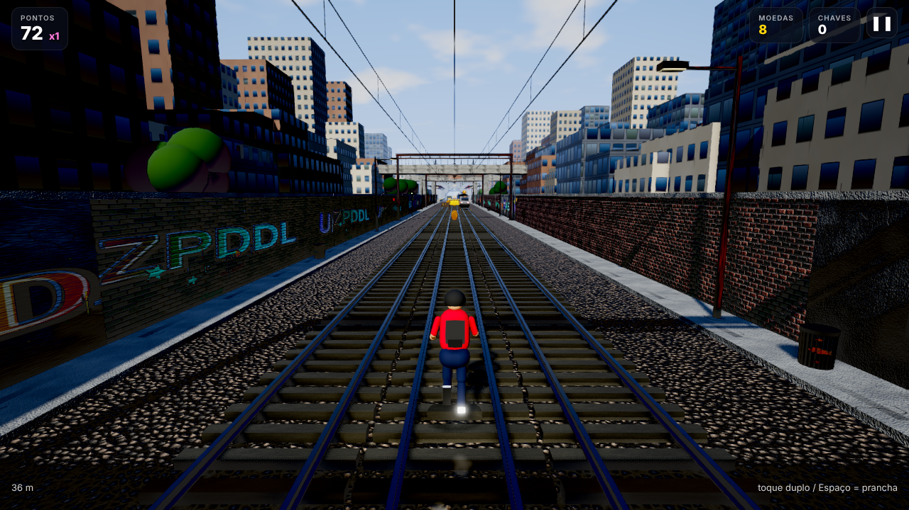

# Fuga nos Trilhos

Endless runner 3D em três pistas, jogável no navegador (HTML5 + WebGL2 + Three.js), com
foco em qualidade gráfica. A mecânica e o clima são inspirados em endless runners de metrô;
todo o conteúdo (nome, personagens, perseguidores, texturas, grafites, música e efeitos)
é original e gerado proceduralmente em tempo de carregamento. Nenhum asset é baixado.



## Como rodar

Projeto estático, sem bundler. O Three.js 0.186.1 (versão estável mais recente na data do
projeto) está vendorizado em `vendor/three` (licença MIT) para funcionar offline; o
`importmap` em `index.html` mostra como apontar para o CDN se preferir.

```bash
# na raiz do repositório (River-Raid) ou dentro de fuga-nos-trilhos/
python -m http.server 8080
# ou
npx serve -l 8080
```

Abra `http://localhost:8080/fuga-nos-trilhos/` (ou `http://localhost:8080/` se servir a
pasta do jogo). Precisa de WebGL2 (Chrome, Edge, Firefox, Safari 15+, iOS e Android recentes).

### Screenshots automáticas e checagem de console

```bash
cd fuga-nos-trilhos
npm install              # instala o Playwright (dev) – o Chromium precisa estar disponível
node tools/screenshots.mjs --out screenshots --quality ultra
```

O script carrega a página em headless com `?manual=1` (a simulação avança sem renderizar
em tempo real, porque o SwiftShader é lento), aciona cenários via `window.__game.debug()`
(hora do dia, chuva, zona, jato, batida), captura as imagens e falha se houver qualquer
erro no console.

## Controles

| Ação | Desktop | Celular |
| --- | --- | --- |
| Trocar de pista | ← → ou A D | swipe para os lados |
| Pular | ↑ ou W | swipe para cima |
| Rolar | ↓ ou S | swipe para baixo |
| Prancha (salva de uma batida por 22 s) | Espaço | toque duplo |
| Pausa | Esc ou P | botão ❚❚ |

O swipe é reconhecido no `pointermove` assim que o dedo anda 24 px, sem esperar o
`pointerup`; comandos dados no ar ficam enfileirados (pular/rolar ao pousar).

## Gameplay

- Três pistas; a velocidade sobe de 12 m/s até 32 m/s ao longo de ~4,5 min.
- Obstáculos: trens parados (sobe-se neles por rampas ou com o tênis de mola), trens vindo
  na sua direção (buzina, faróis e faíscas avisam; batida frontal = fim), barreiras baixas
  (pular), barreiras altas e arcos estreitos (rolar), cones e tapumes (pular).
- Tropeçar em barreira/cone/tapume ou bater na lateral de um trem chama o fiscal e o
  cachorro. Dois tropeços em 5,5 s = capturado. Batida frontal/trem em movimento = fim
  imediato, com câmera lenta e ragdoll.
- Coletáveis: moedas (fileiras e arcos, também sobre os trens), ímã, mochila a jato
  (voa acima dos trens), tênis de mola (super pulo), multiplicador x2, prancha e chaves.
- Pontuação = distância × 2 × multiplicador. Recorde, moedas, chaves, pranchas, skins e
  missões ficam em `localStorage`.
- Chaves permitem continuar depois da batida (custo 1, 2, 4 chaves; até 3 vezes).
- Loja com 8 skins originais; 3 missões ativas por vez (15 definidas).

### Geração da pista e rota garantida

A pista é uma fila de 8 chunks de 60 m. Cada chunk recebe linhas de obstáculos espaçadas
de 23 m (início) a 13 m (dificuldade máxima, a 4,5 km). Um "caminho dourado" percorre as
pistas e só muda de pista (sempre para a vizinha) com intervalo mínimo de 14 m; nas células
do caminho dourado só entram obstáculos passáveis (pular/rolar) ou nada. Trens parados nunca
invadem o *corredor* dourado (a pista dourada entre duas linhas, com 12 m de margem em cada
ponta para a troca de pista, incluindo a continuidade entre chunks); trens em movimento só
entram em pistas que estavam livres no chunk anterior e que o caminho dourado não usa.

O piloto automático (`src/autopilot.js`) joga o modo demo do menu e as screenshots usando
apenas os registros de obstáculos: uma programação dinâmica sobre (pista × nível chão/topo
de trem × 40 células de 2 m) escolhe a troca de pista, e pulo/rolamento são reativos por
distância. Ele serve de teste de "rota possível": em `tools/` o script de screenshots e o
teste de sobrevivência usado no desenvolvimento rodaram 6 sementes por 120 s (≈2,9 km, até
32 m/s) sem nenhuma batida ou tropeço.

## Arquitetura

| Módulo | Responsabilidade |
| --- | --- |
| `src/main.js` | Bootstrap, loop com *fixed timestep* (60 Hz) + interpolação, estados (`menu → running → paused → dead → gameover`), pontuação, power-ups, clima, rebase do mundo, qualidade dinâmica, API de depuração. |
| `src/config.js` | Constantes de gameplay, presets gráficos e detecção de GPU. |
| `src/utils.js` | RNG com seed, easing, `Pool`, helpers. |
| `src/textures.js` | Texturas procedurais (canvas): concreto, asfalto com poças, brita (Worley), metal pintado com janelas/portas/logo/sujeira/ferrugem/arranhões, frente de trem com faróis emissivos, fachadas com janelas acesas aleatórias, tijolos, madeira, chapa corrugada, ladrilhos, grafites originais (letras aleatórias, gradientes, contorno, sombra 3D, escorridos, respingos, tags), placas, anúncios inventados, néons, skyline e sprites de partículas. Normal maps por Sobel. |
| `src/materials.js` | `MeshStandard/PhysicalMaterial` compartilhados; injeções em `onBeforeCompile`: molhado global (`uWet`), UV em espaço de mundo para fachadas instanciadas, giro das moedas no vertex shader. |
| `src/geom.js` | Merge de geometrias (sem dependência), caixas/cilindros posicionados, cunha de rampa, perfil I do trilho extrudado. |
| `src/environment.js` | Céu em shader (gradiente, sol, halo, nuvens fbm, estrelas, brilho urbano), PMREM periódico do céu, sol direcional com sombra que segue o jogador (snap em texel), hemisfério, neblina, ciclo de hora do dia (~6 min por ciclo), chuva, pool de luzes de poste, faróis de trem (spot), lanterna do fiscal, luzes de túnel. |
| `src/track.js` | Chunks pooled, zonas (urbano, estação, pátio, viaduto, túnel, industrial), props por zona, prédios em `InstancedMesh` (3 fachadas), padrões de obstáculos, moedas, power-ups, trens em movimento, emissores de fumaça, rebase. |
| `src/props.js` | 30 builders de props (muros com grafite, postes, pórticos de catenária, viaduto rodoviário, árvores, plataformas com cobertura/bancos/placas, galpões, contêineres, mastros de luz, parapeitos, pilares, túnel, portais, fábricas, chaminés, tubulações, tanques, tapumes, outdoors, barris, sinais, ventilação, fiação). |
| `src/obstacles.js` | Modelos: trens (1–3 vagões, 5 pinturas, truques, ar-condicionado, pantógrafo, faróis), barreiras baixa/alta, cone, tapume, rampa, arco; pools e registros de colisão. |
| `src/collectibles.js` | Moedas (`InstancedMesh`, 1500) e power-ups (pool de modelos procedurais). |
| `src/player.js` | Personagem por geometria (cabeça, tronco, membros, mochila, acessórios por skin), animações procedurais (corrida com balanço, pulo, rolamento, troca de pista com inclinação, tropeço, ragdoll, prancha, jato), física cápsula × AABB, topo de trem e rampas. |
| `src/chaser.js` | Fiscal com lanterna (spot light real) e cachorro. |
| `src/particles.js` | Sistema CPU (Points + shader; faíscas, poeira e folhas, brilho de moedas, chama/fumaça do jato, vapor, respingos) e chuva 100% na GPU. |
| `src/postfx.js` | `EffectComposer`: GTAO, bloom, passe final (motion blur radial por velocidade, aberração cromática, vinheta, color grading por hora do dia, lens flare com fantasmas), `OutputPass` (ACES + sRGB) e SMAA; MSAA 4x no Ultra. |
| `src/camera.js` | Câmera em 3ª pessoa, FOV 62→80 com a velocidade, inclinação, shake, câmera lenta orbital na batida, câmera do menu. |
| `src/audio.js` | Web Audio: 20 efeitos sintetizados, ambiência (vento, chuva, jato, rumble) e loop musical procedural (bateria, baixo, arpejo com delay, pad; tom e progressão sorteados por corrida; andamento sobe com a velocidade). |
| `src/input.js`, `src/ui.js`, `src/save.js`, `src/skins.js`, `src/missions.js`, `src/autopilot.js` | Entrada, interface, persistência, skins, missões, piloto automático. |

**Sem alocação no loop**: pools de chunks, props, obstáculos, registros, partículas e
power-ups são pré-aquecidos no carregamento (todos os shaders são compilados antes do menu);
vetores temporários são reutilizados; moedas (slots compactos, `mesh.count` = ativas) e
prédios são instanciados; cada prop tem suas malhas mescladas por material. Medido no preset
Alto: ~150–200 k triângulos e ~250–350 objetos por passe (3 passes: sombra, GTAO e cor).
**Rebase**: a cada 2000 m o mundo inteiro é deslocado para manter a precisão de float
(sombras estáveis).

## Presets gráficos

| Preset | Pixel ratio | Sombras (PCF Vogel, raio) | GTAO | Bloom | AA | Motion blur / aberração | Partículas |
| --- | --- | --- | --- | --- | --- | --- | --- |
| Baixo | 1 | 1024, raio 1 | não | não | não | não | 35 % |
| Médio | ≤1.5 | 2048, raio 2 | não | sim | SMAA | blur sim / aberração não | 70 % |
| Alto | ≤2 | 2048, raio 3 | sim | sim | SMAA | sim | 100 % |
| Ultra | ≤2 | 4096, raio 4 | sim (16 amostras) | sim | MSAA 4x + SMAA | sim | 140 % |

As sombras usam o `PCFShadowMap` do Three r186 (comparação por hardware com 5 amostras em
disco de Vogel e ruído por pixel; `PCFSoftShadowMap` foi removido nessa versão), com
`normalBias` para evitar acne e a câmera de sombra encaixada no grid de texels para não
tremer.

O preset é escolhido pelo nome da GPU (`WEBGL_debug_renderer_info`) e tipo de dispositivo;
nos primeiros 6 s de corrida, se a média ficar abaixo de 42 fps, o jogo baixa um preset,
reduz o pixel ratio e desliga o GTAO (e salva a escolha). Cada efeito pode ser ligado ou
desligado em Configurações. `?quality=low|medium|high|ultra` força um preset.

Parâmetros de URL úteis: `tod=18.2` (hora), `rain=1`, `speed=28`, `seed=7`, `auto=1`
(piloto automático), `manual=1` (sem loop; use `__game.debug().advance(s)`).

## Decisões de projeto

- **Three.js vendorizado** em vez de CDN por padrão: o jogo funciona offline e em redes
  que bloqueiam CDNs; o importmap documenta o caminho do CDN.
- **Sem Rapier**: colisões próprias (cápsula × AABB) bastam; o ragdoll da batida é uma
  simulação simples de velocidades angulares por membro com gravidade e quique.
- **Sombra única que segue o jogador** (frustum de 76 m, snap em texel) em vez de CSM: o
  CSM do Three exige `setupMaterial` em todo material e conflita com as injeções de shader
  usadas em prédios/moedas/molhado. A qualidade perto do jogador é maior assim.
- **HDRI**: o PMREM é gerado do próprio céu procedural (atualizado a cada 2–6 s conforme o
  preset), para que a iluminação ambiente acompanhe o ciclo do dia sem baixar arquivos.
- **Altura do jato = 4,6 m**: acima dos trens (3,3 m) e abaixo da fiação (6,6 m); a
  cobertura das estações (8 m) e os pórticos (9 m) foram elevados para o voo passar.
- **Chuva na GPU**: 2600 gotas animadas só no vertex shader; respingos e chão molhado
  (`uWet` reduz roughness e escurece difuso) completam o efeito. Sem reflexos em espaço de
  tela (caros demais para celular): as "poças de luz" sob postes, luminárias e no túnel são
  decais aditivos cuja opacidade segue a noite e a chuva.
- **Música procedural**: tom e progressão (i–VI–III–VII ou i–VII–VI–VII) sorteados por
  corrida, sequenciador de 16 passos agendado com antecedência de 200 ms.

## Screenshots

As imagens em `screenshots/` foram geradas pelo script acima no preset Ultra (1280×720,
renderização por software, por isso sem medir fps).
