# Wobble Rush

Jogo web 3D de corrida de obstáculos estilo *battle royale* (32 bonecos, 3 rodadas, só um fica de pé), inspirado no gênero de *Fall Guys / Stumble Guys*, construído do zero com **Three.js + Rapier**. Nome, personagens, mapas e todos os assets são originais e gerados proceduralmente — não há nenhum arquivo de textura, modelo ou áudio externo.

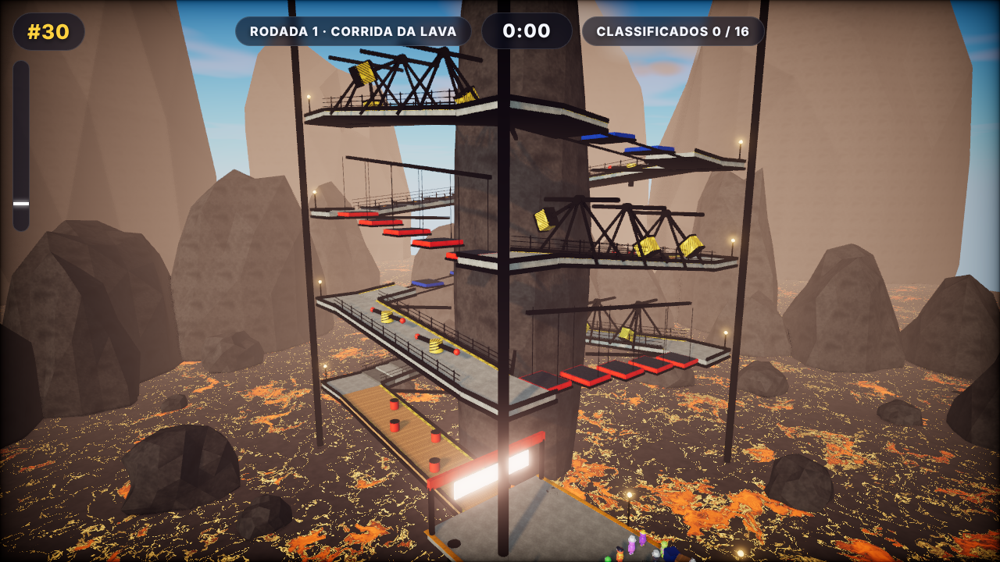

## Como rodar

O projeto é 100% estático (HTML + ES modules). Basta servir a pasta `tumble-rush/`:

```bash
cd tumble-rush
npx serve .            # ou: python -m http.server 8080
# abra http://localhost:8080 (ou a porta que o serve indicar)
```

Não há build nem dependências de runtime. As bibliotecas (Three.js 0.186.1 e Rapier 3D compat 0.21.0) estão **vendoradas** em `vendor/` e resolvidas por `importmap`, para que o jogo funcione offline e de forma determinística. Se preferir CDN, basta trocar as URLs do `importmap` em `index.html` (por exemplo `https://cdn.jsdelivr.net/npm/three@0.186.1/build/three.module.js`).

Requisitos: navegador com WebGL2 (Chrome, Edge, Firefox e Safari recentes).

## Controles

| Ação | Teclado / mouse | Gamepad | Celular |
| --- | --- | --- | --- |
| Mover | WASD / setas | Analógico esquerdo | Joystick virtual |
| Pular | Espaço | A | Botão PULAR |
| Mergulho | Shift (ou E) | X / B | Botão MERGULHO |
| Câmera | Mouse (clique para travar o cursor) | Analógico direito | Arrastar na metade direita da tela |
| Pausar | Esc | Start | Botão II |

## Estrutura da partida

1. **Lobby** com contagem regressiva.
2. **Rodada 1 — Corrida da Lava** (32 → 16): espiral vertical de passarelas industriais ao redor de uma coluna vulcânica, com martelos, barras giratórias, empurradores, plataformas móveis, esteiras e pedras de salto, enquanto a lava sobe. Quem fica para trás é eliminado pela lava.
3. **Rodada 2 — Pista dos Pêndulos** (16 → 8): corrida em linha sobre o mar com martelos, barras giratórias, esteiras com bumpers, escorregador de gosma, ventiladores que levantam o jogador por cima de um muro, jump pads e empurradores. Cair devolve ao último checkpoint.
4. **Final — Blocos que Somem** (8 → 1): três camadas de hexágonos que desaparecem ao pisar; o último em pé vence.
5. **Resultado** com pódio.

## Arquitetura

```
index.html            — markup da UI (menus, HUD, touch) + importmap
src/main.js           — bootstrap: carrega Rapier (WASM), detecta GPU, cria Settings/UI/Game
src/core/
  Game.js             — máquina de estados (MENU → LOBBY → COUNTDOWN → RACING → ROUND_END → RESULTS),
                        loop com timestep fixo (60 Hz) + interpolação, rodadas, classificação, eventos
  Renderer.js         — WebGLRenderer (sRGB, ACES, PCF) + EffectComposer: GTAO, bloom, DoF, grade/vinheta/
                        speed blur, OutputPass, SMAA; presets ligam/desligam cada passe
  Physics.js          — wrapper do Rapier: mundo, buffers de interpolação, raycasts, grupos de colisão
  Camera.js           — terceira pessoa com suavização, colisão por raycast, FOV por velocidade, shake
  Input.js            — teclado, mouse (pointer lock), Gamepad API, touch
  Audio.js            — efeitos sintetizados com Web Audio (osciladores + ruído filtrado), ambiente
  Settings.js         — presets Baixa/Média/Alta/Ultra + overrides, persistidos em localStorage
  GPUDetect.js        — heurística (renderer string, memória, núcleos, mobile) para escolher o preset
src/gfx/
  Textures.js         — geração procedural (canvas): concreto, metal escovado, borracha, madeira,
                        tinta com sujeira/arranhões, rocha, listras de perigo, atlas de padrões, olhos
  Materials.js        — MeshPhysicalMaterial para cada superfície; registra materiais no CSM
  Environment.js      — Sky procedural + sol, PMREM a partir do céu, CSM (cascaded shadow maps),
                        névoa exponencial, luz hemisférica, nuvens em movimento
  Lava.js / Water.js  — shaders animados (fbm com domain warping, emissivo HDR para o bloom)
  Particles.js        — pools de partículas (poeira, faíscas, brasas, fumaça, confete, rastro)
  Rocks.js            — geometria de rochas/montanhas por deslocamento de ruído
src/entities/
  Character.js        — CharacterSystem: todas as partes do corpo são InstancedMesh (um draw call por
                        parte para os 32 bonecos); animação procedural (idle, corrida, pulo, queda,
                        mergulho, levantar, squash & stretch, piscar, olhos seguem a câmera);
                        ragdoll físico com 6 corpos + 5 juntas esféricas e blend de volta
  Bot.js              — IA por waypoints com ruído lateral, raycasts para vãos/paredes, espera por
                        plataformas móveis, hesitações aleatórias conforme a "habilidade"
  Skins.js            — 12 skins originais (cores, padrão, acessório) + geração aleatória para bots
src/levels/
  LevelBase.js        — helpers de construção (mesh + collider), movers cinemáticos, sensores
                        (hazard, jump pad, ventilador, bounce, finish, checkpoint), eventos de colisão
  LavaClimb.js        — Mapa 1  ·  PendulumRun.js — Mapa 2  ·  HexFall.js — Final
src/ui/               — UI.js (menus, HUD, pódio, touch) e ui.css
tools/                — shoot.mjs/probe.mjs: Playwright headless para screenshots e checagem do console;
                        vendor-addons.mjs: copia os addons do Three.js usados para vendor/
```

### Loop e física

- `requestAnimationFrame` → acumulador → N passos fixos de 1/60 s: IA dos bots → movers cinemáticos
  (`setNextKinematicTranslation/Rotation`) → controle dos personagens → `world.step()` → eventos de
  sensores → eliminações. A renderização interpola transformações entre o passo anterior e o atual.
- Personagens são corpos dinâmicos em cápsula com rotações travadas; o chão é detectado por 5 raycasts.
  Em plataformas cinemáticas, a velocidade da superfície (`linvel + angvel × r`) é somada ao movimento,
  então plataformas móveis e giratórias arrastam o jogador corretamente. Esteiras usam `userData.conveyor`.
- Perigos (martelos, barras) são sensores: ao tocar, a velocidade da superfície do perigo no ponto de
  contato é calculada e o boneco entra em ragdoll com esse impulso. O ragdoll tem colisores próprios e
  volta a ser cápsula quando para de se mover (com blend de 0,45 s da pose física para a animação).
- Quedas de grande altura também causam um "tombo" em ragdoll.

### Presets gráficos

| Preset | GTAO | Bloom | SMAA | DoF | Motion blur | Sombras (CSM) | Escala |
| --- | --- | --- | --- | --- | --- | --- | --- |
| Baixa | – | – | – | – | – | 1 cascata 1K | 0.75 |
| Média | – | ✓ | ✓ | – | – | 2 cascatas 2K | 1.0 |
| Alta | ✓ | ✓ | ✓ | – | – | 3 cascatas 2K | 1.0 |
| Ultra | ✓ | ✓ | ✓ | ✓ | ✓ | 3 cascatas 4K | 1.0 |

O preset inicial é escolhido pela heurística de GPU (`GPUDetect.js`); cada opção pode ser alterada no menu de configurações. Todos os passes podem ser ligados/desligados individualmente.

## Decisões de design (não especificadas no pedido)

- **Bibliotecas vendoradas** em vez de CDN: evita falhas de rede e garante versão fixa; a troca para CDN é um edit no importmap.
- **Céu procedural + PMREM** como única fonte de iluminação ambiente (sem HDRI externo): mantém o projeto offline e determinístico; a intensidade do ambiente é baixa (~0,16) porque o céu do Three.js é muito luminoso em HDR.
- **Ragdoll com 6 corpos** (cabeça, tronco, 2 braços, 2 pernas): suficiente para o efeito cômico com 32 bonecos simultâneos sem custo excessivo.
- **Bots instanciados**: cada parte do corpo é um `InstancedMesh`; o padrão da skin vem de um atlas e dois atributos de cor por instância (patch no shader do `MeshPhysicalMaterial`).
- **Mapa 2 com checkpoints** (cair não elimina): deixa a rodada mais justa e a eliminação acontece pelo corte de classificados.
- **Lava** começa a subir quando a largada é dada e acelera com o tempo; quem cai da borda interna do espiral cai na volta de baixo (perde tempo), quem cai da borda externa cai na lava.
- **Sombras**: `PCFSoftShadowMap` foi removido no Three.js r186; usamos PCF com `normalBias` para evitar acne.

## Testes automatizados

`node tools/shoot.mjs <rodada> <prefixo> [segundos]` abre o jogo no Chromium headless (SwiftShader), roda a simulação com dt fixo (o jogador é dirigido pela IA), tira screenshots em preset Ultra (lobby, meio da corrida, lava subindo, ragdoll) e imprime mensagens de erro/aviso do console. Requer `npm i` (Playwright) e o Chromium do Playwright.

## Screenshots

Capturas feitas pelo harness headless (`tools/shoot.mjs`, preset Alta, SwiftShader) e salvas em `screenshots/`:

| | |
| --- | --- |
| 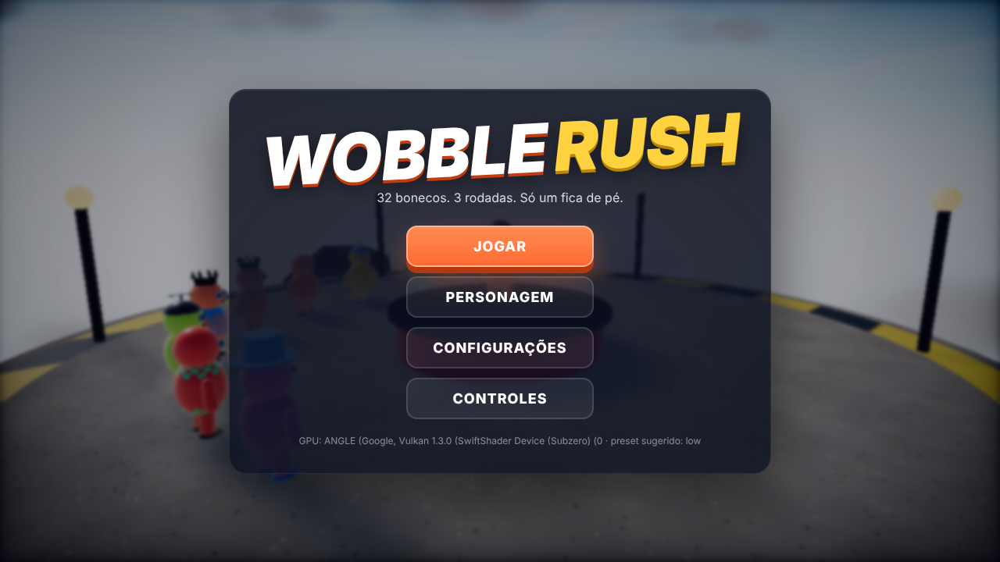 Menu com palco 3D ao fundo | 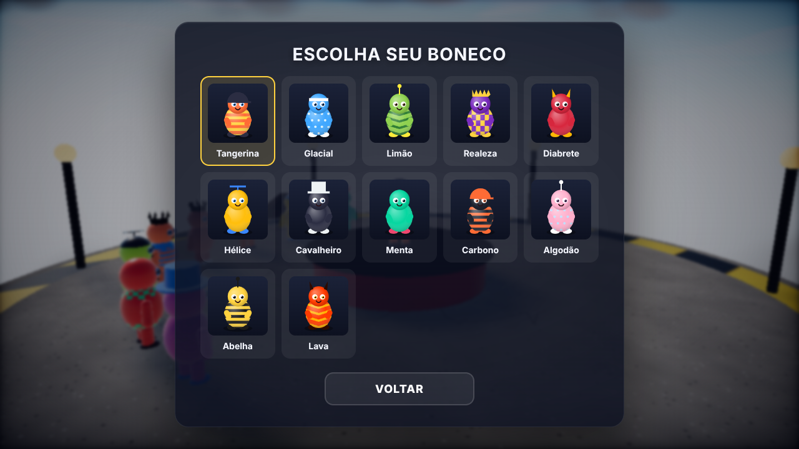 Seleção de personagem |
|  Corrida da Lava — plano geral (câmera de abertura) | 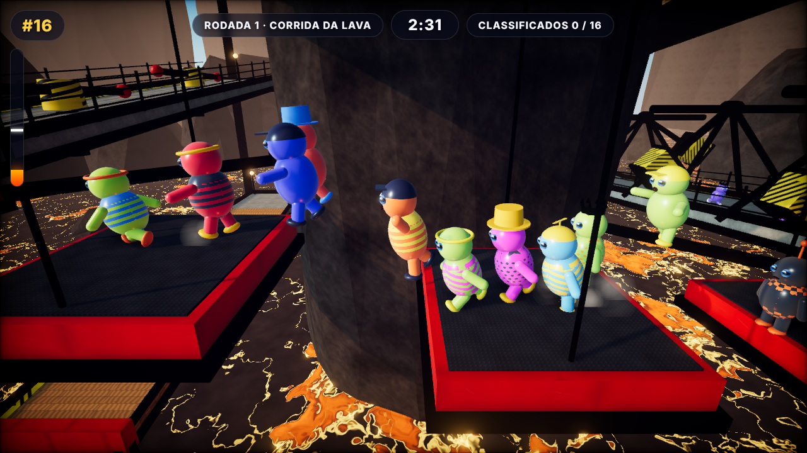 Corrida da Lava — meio da corrida |
| 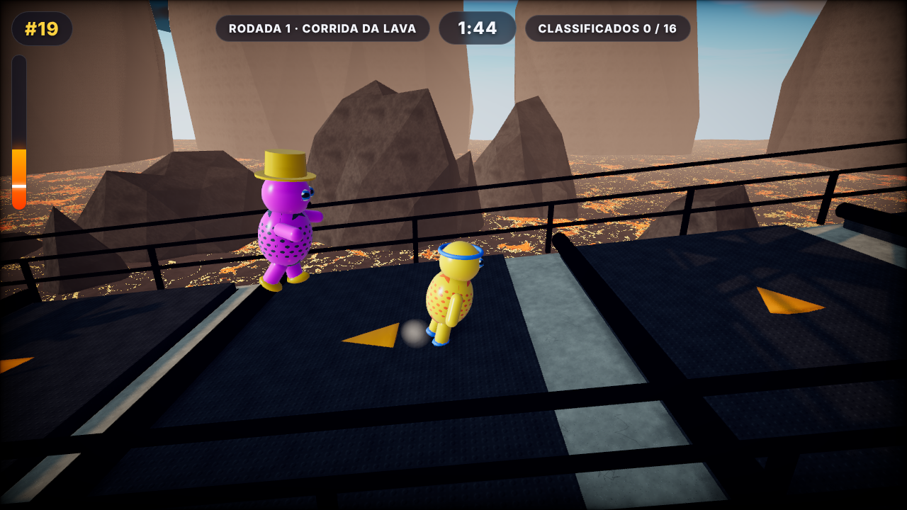 Lava subindo | 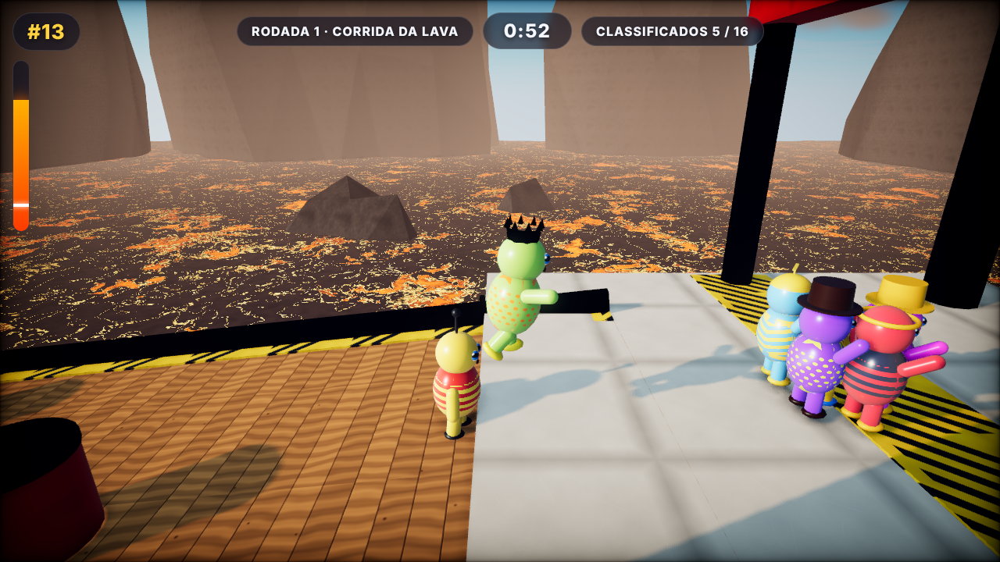 Chegada |
| 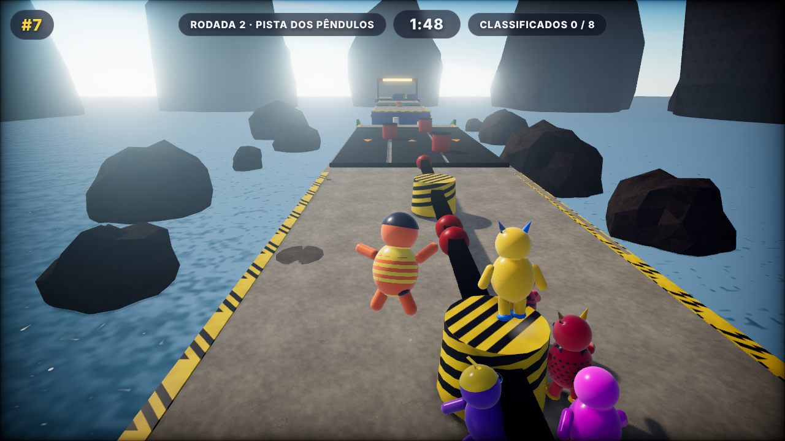 Pista dos Pêndulos | 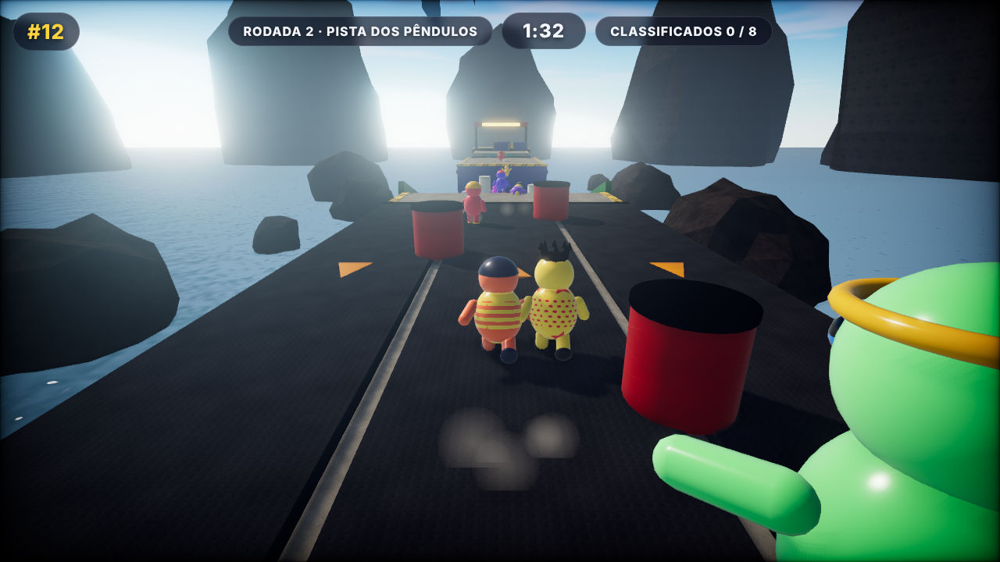 Escorregador de gosma |
| 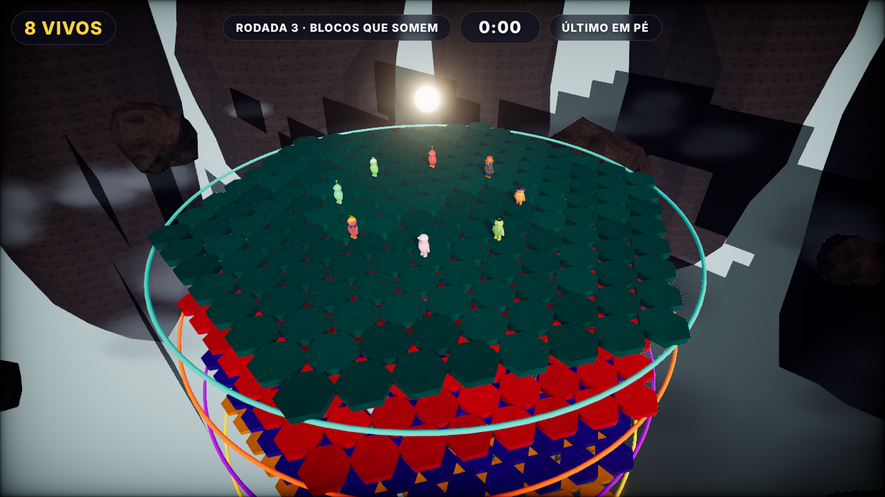 Blocos que Somem | 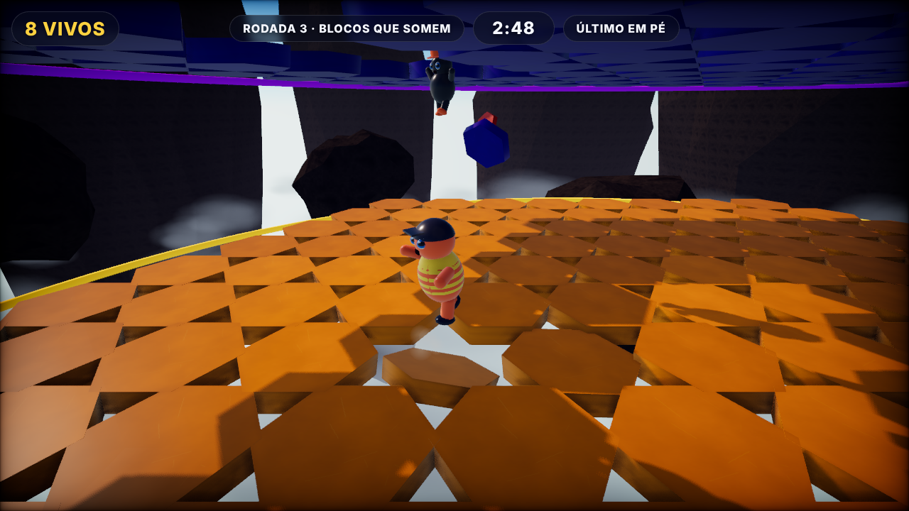 Blocos caindo |
| 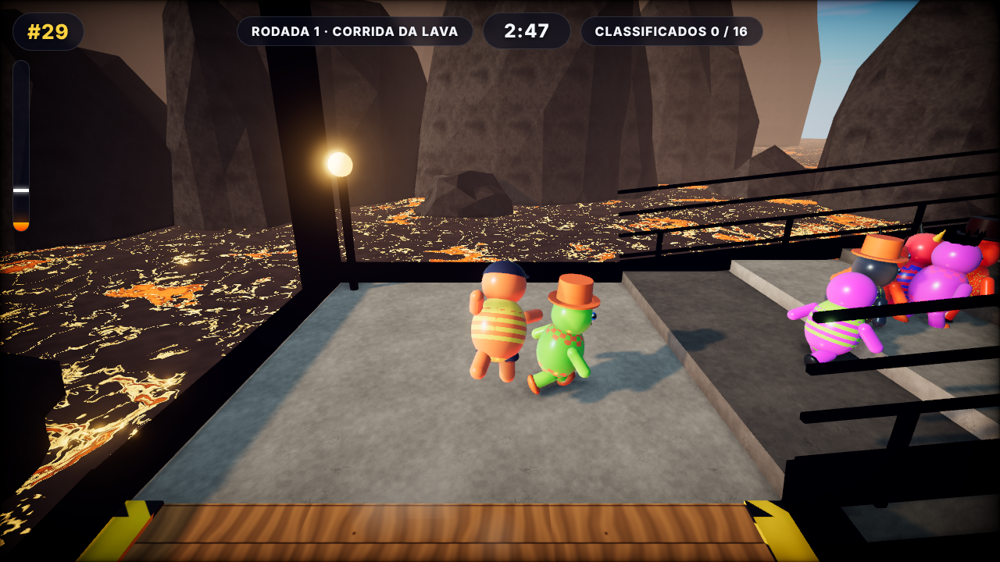 Ragdoll | 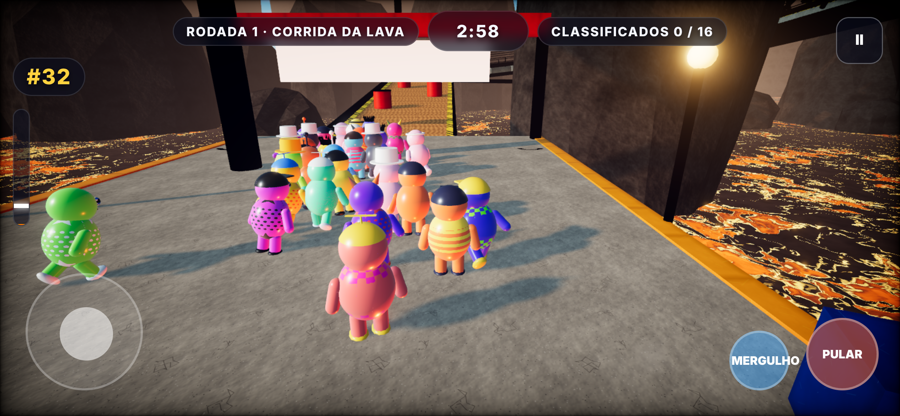 Layout mobile (joystick virtual) |

## Passes de polimento gráfico (registro)

1. **Exposição e ambiente** — o céu procedural do Three.js é muito luminoso em HDR; a primeira versão ficou estourada. Solução: `environmentIntensity` ~0,16, sol a 5 lux, exposição ~1,0 e, na terceira passada, um fator de brilho só para o domo visível (`uSkyScale`), que deixou o horizonte legível sem escurecer os materiais.
2. **Lava** — passou de "amarelo chapado" para crosta escura com canais de magma, borda incandescente e veias finas (duas camadas de fbm com domain warping), com as veias atenuadas à distância para não cintilar.
3. **Desempenho** — de 1 741 draw calls / 2,3 M triângulos para ~450 / ~0,6 M por quadro com *batching* de geometria estática por material, instancing dos bonecos e tesselação menor nas rochas.
4. **Composição** — câmera mais alta e afastada, câmera de abertura sobrevoando o mapa no lobby, grades e cercas nas passarelas (também corrigiram mortes em massa por ragdolls lançados), decoração da praça inicial, bloom restrito a emissivos (limiar 2,4).
5. **Bugs encontrados pelos testes automáticos** — recompilação de shaders ao reconstruir o CSM (chave de programa por instância), tunelamento de ragdolls em paredes finas (paredes de 0,9 m + CCD no tronco), blocos hexagonais armando antes da largada, IA parando em cima de blocos que somem.

## Licenças

Código do jogo: MIT. Three.js (MIT) e Rapier (Apache-2.0) em `vendor/` com suas licenças.
